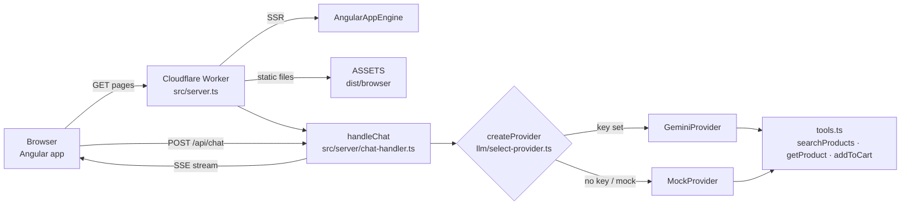

# SmartCart

SmartCart is a small shop built with Angular 22 and rendered on the server in a Cloudflare Worker. It has an AI shopping assistant that streams its answers and can search the catalog and add items to your cart. The assistant uses Google Gemini when you give it an API key, and a deterministic mock provider when you don't, so everything runs and tests offline.

This repository is the companion app for the hands-on workshop **AI-Powered Code Review, Testing & CI/CD with Angular**. Follow the guide online at **[smartcart-workshop-guide.santosh-yadav198613.workers.dev](https://smartcart-workshop-guide.santosh-yadav198613.workers.dev)**. Its source is in [`workshop/`](workshop/README.md). To build the app yourself from an empty folder, see [`workshop/build-from-scratch.md`](workshop/build-from-scratch.md).

## Features

- A product catalog (20 products) with search, category and max-price filters, product detail pages and a cart stored in `localStorage`.
- Server-side rendering with hydration. `/` and `/product/:id` render on the server, while `/cart` is client-only (`src/app/app.routes.server.ts`).
- The **"✨ Ask AI" assistant**, which streams replies over Server-Sent Events from `POST /api/chat` and calls tools: `searchProducts`, `getProduct` and `addToCart`.
- Pluggable LLM providers. `GeminiProvider` uses `@google/genai`, and `MockProvider` is used for demo mode and tests. A demo banner shows when the mock is active.

## Stack

- Angular 22: zoneless, standalone components, signals, `@angular/ssr`
- Cloudflare Workers with Wrangler 4 and static assets
- Gemini via `@google/genai`
- Vitest 5 through `@angular/build:unit-test` in jsdom, with v8 coverage
- Playwright for e2e against `wrangler dev`
- ESLint with angular-eslint, and Prettier
- GitHub Actions CI, CodeRabbit review and Cloudflare Workers Builds deploys

## Quick start

You need Node 24 and pnpm 12. Install pnpm with `npm install -g pnpm@12.15.0`.

```bash
pnpm install
pnpm start            # http://localhost:4200, with the mock assistant unless GEMINI_API_KEY is set
```

To run the real Worker locally:

```bash
cp .dev.vars.example .dev.vars   # optional: add GEMINI_API_KEY
pnpm preview                     # build, then wrangler dev on http://localhost:8787
```

## Scripts

| Script               | Command                                        | What it does                                                                     |
| -------------------- | ---------------------------------------------- | -------------------------------------------------------------------------------- |
| `pnpm start`         | `ng serve`                                     | Dev server with SSR on port 4200                                                 |
| `pnpm build`         | `ng build`                                     | Builds `dist/browser` and the Worker `dist/server/server.mjs`                    |
| `pnpm watch`         | `ng build --watch --configuration development` | Rebuilds on change                                                               |
| `pnpm preview`       | `pnpm run build && wrangler dev`               | Runs the built Worker locally on port 8787                                       |
| `pnpm run deploy`    | `pnpm run build && wrangler deploy`            | Manual deploy to Cloudflare. Use `run`, because `pnpm deploy` is a pnpm built-in |
| `pnpm test`          | `ng test --watch=false`                        | Vitest unit tests, run once                                                      |
| `pnpm test:watch`    | `ng test`                                      | Vitest in watch mode                                                             |
| `pnpm test:coverage` | `ng test --watch=false --coverage`             | Unit tests with a coverage report in `coverage/`                                 |
| `pnpm e2e`           | `pnpm build && playwright test`                | Playwright against `wrangler dev` with the mock provider                         |
| `pnpm lint`          | `ng lint`                                      | ESLint                                                                           |
| `pnpm typecheck`     | `tsc --noEmit -p …` (app, spec, e2e)           | Type-checks every tsconfig                                                       |
| `pnpm cf-typegen`    | `wrangler types`                               | Generates Worker binding types                                                   |

## Environment variables

| Variable             | Default            | Purpose                                                     |
| -------------------- | ------------------ | ----------------------------------------------------------- |
| `GEMINI_API_KEY`     | none               | Turns on the Gemini provider. Without it the mock is used   |
| `GEMINI_MODEL`       | `gemini-2.5-flash` | The Gemini model name                                       |
| `SMARTCART_PROVIDER` | none               | Set it to `mock` to force the mock provider even with a key |

Where each environment reads them from:

- `pnpm start` (`ng serve`) reads `process.env`, for example `GEMINI_API_KEY=… pnpm start`.
- `pnpm preview` and `wrangler dev` read `.dev.vars`.
- In production, set them in the Worker's **Settings → Variables & Secrets**, or with `pnpm wrangler secret put GEMINI_API_KEY`.

## Architecture



| Path          | Contents                                                                                            |
| ------------- | --------------------------------------------------------------------------------------------------- |
| `src/app/`    | Angular pages (products, cart), the header and the assistant panel and `ChatService`                |
| `src/server/` | The Worker side: `chat-handler.ts` (validation and SSE), `tools.ts`, `sse.ts`, and `llm/` providers |
| `src/shared/` | Code shared by both sides: products, `product-filter.ts`, `AgentEvent` types                        |
| `e2e/`        | Playwright specs and the `gotoHydrated` helper                                                      |
| `workshop/`   | The workshop guide, prompts and the seeded-bug patch                                                |

## Deploy

Deploys run through **Cloudflare Workers Builds**, not GitHub Actions:

1. In the Cloudflare dashboard, go to **Workers & Pages → Create application → Import a repository** and select this repo.
2. Keep the Worker name `smartcart-workshop`, which must match `wrangler.jsonc`. Set the build command to `pnpm build` and the deploy command to `pnpm wrangler deploy`.
3. Optionally add `GEMINI_API_KEY` as a secret under **Settings → Variables & Secrets**.
4. Pushes to `main` deploy to `smartcart-workshop.<subdomain>.workers.dev`. Turn on preview builds to get a URL for every PR.

CI (`.github/workflows/ci.yml`) gates `main` with the `quality` job (lint, typecheck, unit tests with coverage, build) and the `e2e` job. See [workshop/05-deploy.md](workshop/05-deploy.md) for the full walkthrough.

## Workshop guide site

[`site/`](site/) is an [Astro Starlight](https://starlight.astro.build) site that publishes `workshop/*.md` (everything except the facilitator notes) at https://smartcart-workshop-guide.santosh-yadav198613.workers.dev. It adds search, copy buttons and progress tracking that is saved in the browser. Edit the Markdown in `workshop/`. The site regenerates its pages from there on every build.

```sh
pnpm --filter smartcart-workshop-guide dev     # local preview on http://localhost:4321
pnpm --filter smartcart-workshop-guide build   # sync + build + link check
pnpm --filter smartcart-workshop-guide e2e     # Playwright smoke tests
```

`.github/workflows/site.yml` builds and tests the site on PRs. On pushes to `main` it deploys the site to the `smartcart-workshop-guide` Worker, once the `CLOUDFLARE_API_TOKEN` and `CLOUDFLARE_ACCOUNT_ID` repository secrets are set.
