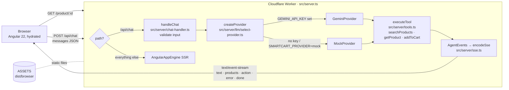

# 00 · Setup

|                     |                                                                   |
| ------------------- | ----------------------------------------------------------------- |
| **Goal**            | Get SmartCart running locally and understand how it fits together |
| **Time box**        | 5 minutes (0–5)                                                   |
| **Starting branch** | `step-0-start`                                                    |

> Want to build the app yourself first? Follow [build-from-scratch.md](build-from-scratch.md) before the session. It covers the scaffold commands and the prompts for every feature. In the live session everyone starts from the ready-made app below.

## Steps

1. **Fork** [`santoshyadavdev/smartcart-workshop`](https://github.com/santoshyadavdev/smartcart-workshop). On the "Create a new fork" page, **untick "Copy the `main` branch only"**. You need every `step-*` branch.
2. **Clone your fork** and check out the starting branch:

   ```bash
   git clone https://github.com/<you>/smartcart-workshop.git
   cd smartcart-workshop
   git checkout step-0-start
   ```

3. **Install** pnpm 10 (skip if `pnpm -v` already prints 10.x), then the dependencies.

   ```bash
   npm install -g pnpm@10.33.4
   pnpm install
   ```

4. **Run the dev server.** This runs `ng serve` with SSR:

   ```bash
   pnpm start
   ```

   Open <http://localhost:4200>.

5. **Try the assistant in demo mode.** Click the floating **✨ Ask AI** button in the bottom-right corner. You'll see the banner _"Demo mode — responses are simulated. Add a GEMINI_API_KEY to use Gemini."_ Try the suggestions, or type:
   - `show me headphones under $100`
   - `add the cheapest mug to my cart`. The cart badge goes to 1.

### Optional: use real Gemini

There are two ways to run the app locally, and each reads the key differently:

| How you run it                  | Where the key comes from                                                                                     | Command                                                        |
| ------------------------------- | ------------------------------------------------------------------------------------------------------------ | -------------------------------------------------------------- |
| `ng serve` (`pnpm start`)       | `process.env`. `src/server.ts` builds the env from `GEMINI_API_KEY`, `GEMINI_MODEL` and `SMARTCART_PROVIDER` | `GEMINI_API_KEY=your-key pnpm start`                           |
| `wrangler dev` (`pnpm preview`) | `.dev.vars`, which Wrangler loads as Worker bindings                                                         | `cp .dev.vars.example .dev.vars`, edit it, then `pnpm preview` |

`.dev.vars.example` has `GEMINI_API_KEY=your-key-here` and an optional `SMARTCART_PROVIDER=mock` line. `.dev.vars` is git-ignored.

`pnpm preview` runs `pnpm run build && wrangler dev` and serves the production Worker build at <http://localhost:8787>. That's the same runtime as production.

Once a key is set, the demo banner goes away, because the server's `x-smartcart-provider` response header reports `gemini`. To force the mock even with a key, set `SMARTCART_PROVIDER=mock`.

## Architecture tour



These are the files to know:

| Path                         | What it does                                                                                                 |
| ---------------------------- | ------------------------------------------------------------------------------------------------------------ |
| `src/server.ts`              | Worker entry. Routes `/api/chat` to `handleChat` and everything else to Angular SSR                          |
| `src/server/chat-handler.ts` | Validates the request (POST only, at most 20 messages of 2000 chars, last one from the user) and streams SSE |
| `src/server/llm/`            | `LlmProvider` interface, `GeminiProvider` (up to 3 tool rounds), `MockProvider` and `createProvider`         |
| `src/server/tools.ts`        | Tool declarations and `executeTool`. LLM arguments are treated as untrusted                                  |
| `src/shared/`                | Catalog (`products.ts`), `filterProducts` and the `AgentEvent` types shared by client and server             |
| `src/app/assistant/`         | `ChatService` (fetch plus SSE parsing via the `FETCH` token) and the assistant panel                         |
| `src/app/cart/`              | `CartStore` (signals, persisted to `localStorage` in the browser only) and the cart page                     |
| `wrangler.jsonc`             | Worker `smartcart-workshop`, `main: ./dist/server/server.mjs`, assets `./dist/browser`                       |

## Expected result

- SmartCart runs on <http://localhost:4200> and shows the 20-product catalog.
- The assistant answers in demo mode, or through Gemini if you set a key.

## If stuck

- `pnpm: command not found`: run `npm install -g pnpm@10.33.4`.
- `step-0-start` doesn't exist: your fork only copied `main`. Add the original repo as a remote and fetch the branches from it:

  ```bash
  git remote add upstream https://github.com/santoshyadavdev/smartcart-workshop.git
  git fetch upstream
  git checkout -b step-0-start upstream/step-0-start
  git push -u origin step-0-start   # so your fork has it too
  ```

  Do the same for any other `step-*` branch you need.

- Port 4200 busy: run `pnpm start --port 4300`.
