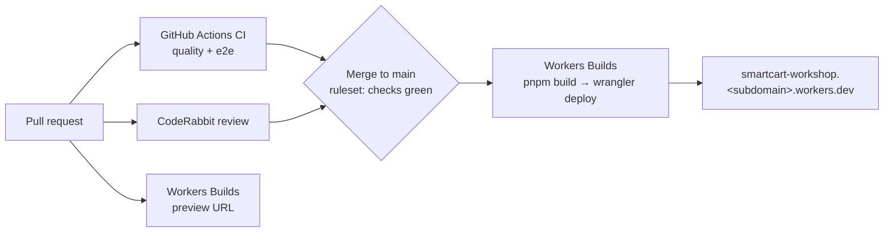
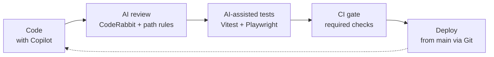

# 05 · Deploy with Cloudflare Workers Builds

|                     |                                                                                              |
| ------------------- | -------------------------------------------------------------------------------------------- |
| **Goal**            | Connect the fork to Cloudflare so that `main` deploys automatically and PRs get preview URLs |
| **Time box**        | 8 minutes (52–60)                                                                            |
| **Starting branch** | `step-4-ci` (or `main`)                                                                      |

## How deploys work here

GitHub Actions **gates** and Cloudflare **deploys**. Cloudflare builds every push to the production branch (`main`). The ruleset from module 04 means `main` only moves after `quality` and `e2e` pass, so only tested code reaches production. No Cloudflare token is stored in GitHub.

`wrangler.jsonc` already describes the Worker:

- `name: "smartcart-workshop"`. This **must match** the Worker name in the dashboard, or the build fails.
- `main: "./dist/server/server.mjs"`, the SSR Worker that `pnpm build` produces.
- `assets.directory: "./dist/browser"`, the static assets, served with the `ASSETS` binding.

## Steps

1. **Push the branch you want live to `main`** on your fork, if it isn't there already. The fork's `main` already contains everything.

2. **Create the Worker from Git.** In the Cloudflare dashboard, go to **Workers & Pages → Create application**. Select **Get started** next to **Import a repository**, connect your GitHub account, and select your `smartcart-workshop` fork.

3. **Configure the build:**

   | Field                 | Value                                                                 |
   | --------------------- | --------------------------------------------------------------------- |
   | Project / Worker name | `smartcart-workshop` (must match `wrangler.jsonc`)                    |
   | Build command         | `pnpm build`                                                          |
   | Deploy command        | `pnpm wrangler deploy` (the default `npx wrangler deploy` also works) |
   | Root directory        | `/` (leave empty)                                                     |

   Don't use `pnpm deploy` as the deploy command. `pnpm deploy` is a pnpm built-in that does something else. The repo's `deploy` script (`pnpm run deploy` = `pnpm run build && wrangler deploy`) also rebuilds, which is what you use for a manual deploy from your laptop.

   The build image ships its own default pnpm version. If the install step complains about the pnpm version or the lockfile, add the build variable `PNPM_VERSION` = `12.15.0` under **Build variables and secrets**.

   Select **Save and Deploy**. Watch the log, then open the `*.workers.dev` URL.

4. **Add the Gemini key (optional).** Without it, the live site runs the mock assistant and shows the demo banner. To add it:
   - Dashboard: go to your Worker → **Settings → Variables & Secrets → Add**, choose type **Secret**, name it `GEMINI_API_KEY` and paste the key. Then **Deploy**.
   - Or use the CLI: `pnpm wrangler secret put GEMINI_API_KEY`.

   You can also set `GEMINI_MODEL`, which defaults to `gemini-2.5-flash`. **Build variables and secrets** are only for the build, so runtime secrets go under **Variables & Secrets**.

5. **Preview builds on PRs.** Go to **Settings → Build → Branch control**. Keep **Production branch** = `main` and tick **Enable Preview Builds**. Each push to another branch runs the build command plus the **Preview command** (default `npx wrangler preview`), which creates or updates a Preview without promoting it to production. Cloudflare posts a comment and a check with the **Preview URL** on the PR. Previews use their own variables and secrets, so add `GEMINI_API_KEY` there too, or the previews stay in demo mode.

6. **Verify.** Open `https://smartcart-workshop.<your-subdomain>.workers.dev`:
   - View the page source of `/product/…`. It's server-rendered HTML.
   - Ask the assistant "show me headphones under $100".
   - Go to Worker → **Deployments → View build history** to see which commit is live.

7. **Optional: tighten production.** Production deploys only come from the production branch (`main`). Combined with the ruleset, that means a deploy only happens after a green, reviewed PR merge. If you'd rather promote releases by hand, set the **Deploy command** to `npx wrangler versions upload`. Each merge then uploads a new version without deploying it, and you promote it from **Deployments**.

## Expected result

A live `*.workers.dev` URL serving SmartCart. Every merged PR redeploys it, and every PR gets a preview URL.

## If stuck

- **Build fails with a name mismatch.** Rename the Worker in the dashboard to `smartcart-workshop`, or change `name` in `wrangler.jsonc` to match.
- **`pnpm: not found` or a lockfile error.** Set `PNPM_VERSION=12.15.0` as a build variable.
- **Every page returns 400 `Header "host" … is not allowed`.** Angular SSR only renders for hosts listed in `allowedHosts` in `src/server.ts`. `*.workers.dev` (including preview URLs) is already there; add your custom domain if you attach one.
- **The assistant shows "demo mode" in production.** The `GEMINI_API_KEY` secret is missing from the production environment, or you added it as a build variable.
- **Manual fallback from your laptop:** `pnpm wrangler login`, then `pnpm run deploy`.

References:

- [Angular on Cloudflare Workers](https://developers.cloudflare.com/workers/framework-guides/web-apps/more-web-frameworks/angular/)
- [Workers Builds](https://developers.cloudflare.com/workers/ci-cd/builds/)

## Wrap-up: the repeatable workflow

To adapt it to your own project:

1. **Teach the reviewer your rules.** Write `path_instructions` for the places where your app breaks, like SSR, the edge runtime or secrets, plus a "tests for new logic" custom check.
2. **Make AI code testable.** Inject your seams (`FETCH`, an LLM `client`, `createProviderFn`) so that AI-written tests can use fakes instead of networks.
3. **Review AI tests like code.** Check they're deterministic, use no network, have meaningful assertions and cover edge cases. Mutate the source and confirm a test fails.
4. **E2E on the real runtime** with a deterministic provider, `page.route` for failures, and web-first waits.
5. **Gate, then deploy.** Make the checks required on `main`, and let the platform deploy from Git. Keep deploy credentials out of CI.

See [prompts.md](prompts.md#module-05-deploy) for prompts that help you apply this to another repo.
