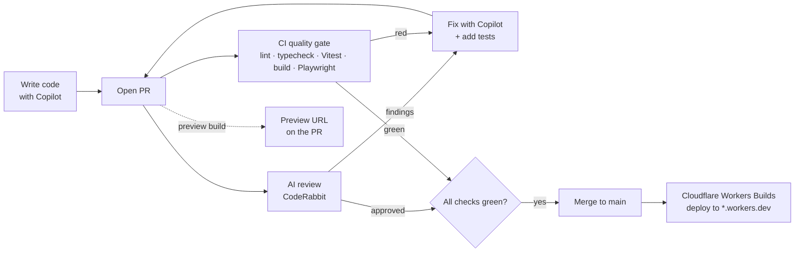

# AI-Powered Code Review, Testing & CI/CD with Angular

A 60-minute hands-on workshop.

## Abstract

AI writes a lot of our code now. The real question is how fast you can trust it. In this workshop you take **SmartCart**, an Angular 22 SSR shop with an AI shopping assistant running on Cloudflare Workers, and wrap it in a delivery pipeline where AI helps at every step:

- **CodeRabbit** reviews every pull request, using rules you write in `.coderabbit.yaml`.
- **GitHub Copilot** drafts the Vitest unit tests and Playwright e2e tests. You review and refine them, including the tricky parts: streaming responses and LLM calls.
- **GitHub Actions** gates every PR on lint, types, tests, a build and e2e.
- **Cloudflare Workers Builds** deploys `main` and gives every PR a preview.

You leave with a workflow you can reuse on your own projects.

## Prerequisites

- Node 24 and pnpm 10. Install pnpm with `npm install -g pnpm@10.33.4`.
- A GitHub account.
- VS Code with GitHub Copilot. The free tier is fine.
- The [CodeRabbit GitHub app](https://github.com/apps/coderabbitai). It's free for public repos.
- A Cloudflare account. The free plan is fine.
- Optional: a Gemini API key from [Google AI Studio](https://aistudio.google.com/apikey). Without one the app uses its built-in mock provider, and every exercise still works.

The repository is [`santoshyadavdev/smartcart-workshop`](https://github.com/santoshyadavdev/smartcart-workshop).

## Agenda

| Time  | Module                                        | You will…                                                         |
| ----- | --------------------------------------------- | ----------------------------------------------------------------- |
| 0–5   | [00 Setup](00-setup.md)                       | Fork, install, run SmartCart and try the assistant                |
| 5–15  | [01 AI code review](01-coderabbit.md)         | Configure CodeRabbit and let it catch seeded bugs in a PR         |
| 15–30 | [02 AI-assisted unit tests](02-unit-tests.md) | Have Copilot write Vitest specs, including streaming and LLM ones |
| 30–42 | [03 E2E tests](03-e2e.md)                     | Have Copilot write Playwright tests against `wrangler dev`        |
| 42–52 | [04 CI](04-ci.md)                             | Add a GitHub Actions quality gate and branch protection           |
| 52–60 | [05 Deploy](05-deploy.md)                     | Ship with Cloudflare Workers Builds, then wrap up                 |

The other files in this folder:

- [build-from-scratch.md](build-from-scratch.md) is self-paced pre-work. It has the commands to scaffold the app and the Copilot prompts to build every feature yourself, ending at `step-0-start`.
- [prompts.md](prompts.md) has every copy-paste prompt for the live modules.
- [facilitator-notes.md](facilitator-notes.md) is for whoever runs the session.

## Checkpoint branches

Each module starts on a branch. If you fall behind, check out the next branch and carry on. Each branch adds to the one before it.

| Branch              | Contains                                                                                                                                                                    | Use it to start |
| ------------------- | --------------------------------------------------------------------------------------------------------------------------------------------------------------------------- | --------------- |
| `step-0-start`      | The full app and all `package.json` scripts. No `.coderabbit.yaml`, no specs except `src/app/app.spec.ts`, no `e2e/`, no `playwright.config.ts` and no `.github/workflows/` | 00, 01          |
| `step-1-coderabbit` | Adds `.coderabbit.yaml`                                                                                                                                                     | 02              |
| `step-2-unit-tests` | Adds the unit specs (`src/**/*.spec.ts`)                                                                                                                                    | 03              |
| `step-3-e2e`        | Adds `playwright.config.ts` and `e2e/`                                                                                                                                      | 04              |
| `step-4-ci`         | Adds `.github/workflows/ci.yml`                                                                                                                                             | 05              |
| `main`              | `step-4-ci` plus the docs                                                                                                                                                   | Reference       |

The `workshop/` folder is on every branch, including the patch used in module 01.

## The repeatable workflow

1. **Code.** Write the change, with Copilot if you like.
2. **AI review.** CodeRabbit reviews the PR against your own rules.
3. **AI-assisted tests.** Copilot drafts the tests and you review them like any other code.
4. **CI.** Nothing merges until the checks pass.
5. **Deploy.** Merging to `main` ships it, and each PR gets a preview.

## Modules

0. [Setup](00-setup.md)
1. [AI code review with CodeRabbit](01-coderabbit.md)
2. [AI-assisted unit tests with Vitest](02-unit-tests.md)
3. [E2E tests with Playwright](03-e2e.md)
4. [CI with GitHub Actions](04-ci.md)
5. [Deploy with Cloudflare Workers Builds and wrap-up](05-deploy.md)
